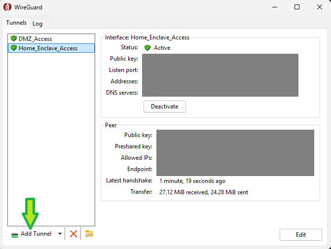
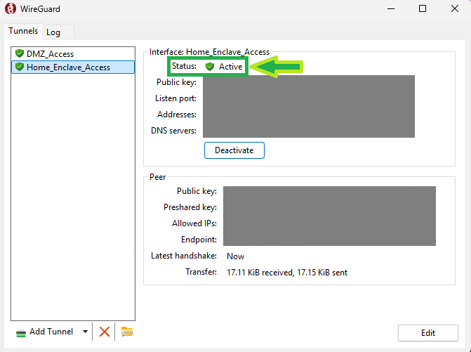
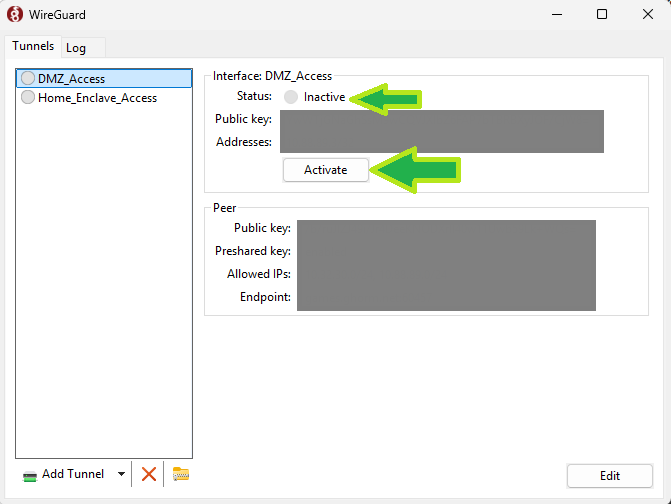
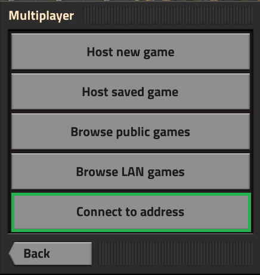
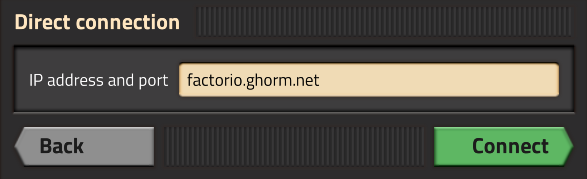

# Table of Contents

* TOC
{:toc}

# Overview
These instructions go over how to use WireGuard to connect to any games.mrghorm.com Factorio servers.  WireGuard is a VPN protocol that uses strong cryptography to ensure that only people with valid keys can connect to and use the games.mrghorm.com Factorio server.  

All users looking to play Factorio or other games on mrghorm.com addresses **must** have a WireGuard connection to do so. For this reason, **the Factorio server does not have a whitelist or password**.  Once you have a valid WireGuard key, just connect straight to factorio.ghorm.net using the Factorio game.

# Instructions

## 1. Install WireGuard

Navigate to [wireguard.com/install](https://www.wireguard.com/install/) and download the installer for your operating system (Windows or macOS)

## 2.  Download and install the WireGuard profile

You will receive a WireGuard profile (for example, "YourName.conf").  If you have not received one, email Matt and a WireGuard profile will be provided.

To install the profile, open WireGuard and click the "Add Tunnel" button.  Find the configuration file (ending in .conf) and open it.

## 3.  Ensure that WireGuard is connected

Make sure you see "Status: Active" near the top of the WireGuard window:

If the status of your WireGuard connection is "Inactive", then press the "Activate" button.

## 4.  Connect to factorio.ghorm.net in Factorio

In Factorio, navigate to **Multiplayer > Connect to address**

Under "Direct connection", type **factorio.ghorm.net**

**Then click connect!**