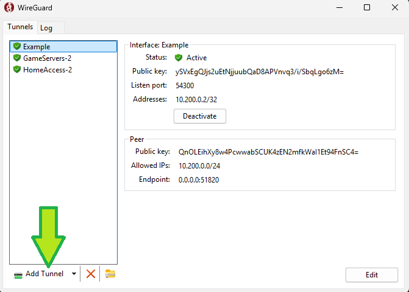
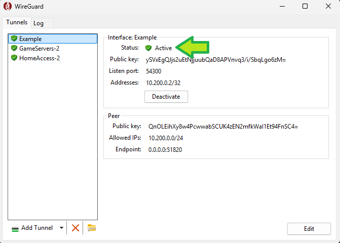
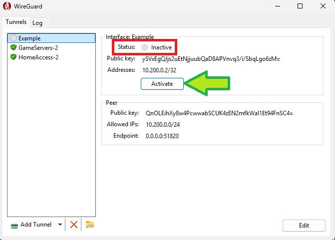
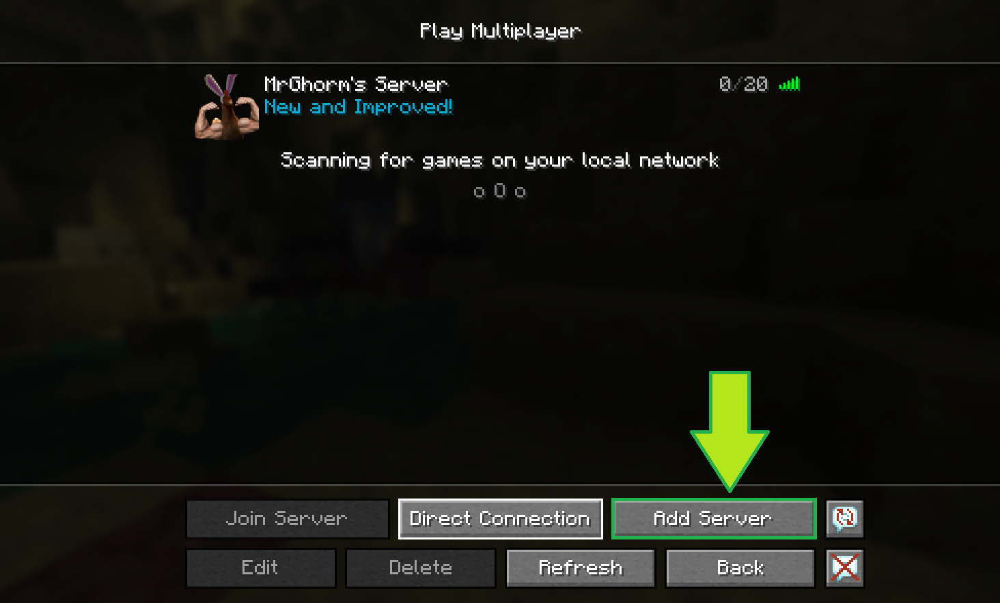
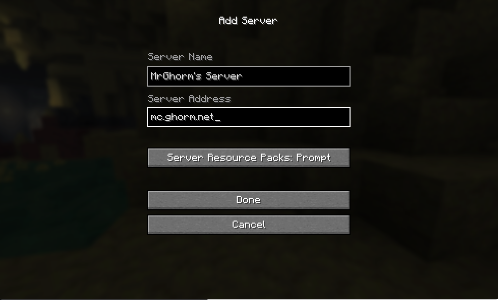

# Table of Contents

* TOC
{:toc}

# Overview
These instructions go over how to use WireGuard to connect to any games.mrghorm.com Minecraft servers.  WireGuard is a VPN protocol that uses strong cryptography to ensure that only people with valid keys can connect to and use the games.mrghorm.com Minecraft server.  

All users looking to play Minecraft or other games on mrghorm.com addresses **must** have a WireGuard connection to do so. For this reason, **the Minecraft server does not have a whitelist or password**.  Once you have a valid WireGuard key, just connect straight to mc.ghorm.net using the Minecraft game.

# Instructions

## 1. Install WireGuard

Navigate to [wireguard.com/install](https://www.wireguard.com/install/) and download the installer for your operating system (Windows or macOS)

## 2.  Download and install the WireGuard profile

You will receive a WireGuard profile (for example, "YourName.conf").  If you have not received one, email Matt to receive your WireGuard profile.

To install the profile, open WireGuard and click the "Add Tunnel" button.  Find the configuration file (ending in .conf) and open it.

## 3.  Ensure that WireGuard is connected

Make sure you see "Status: Active" near the top of the WireGuard window:

If the status of your WireGuard connection is "Inactive", then press the "Activate" button.

## 4.  Connect to mc.ghorm.net in Factorio

In Minecraft, navigate to **Multiplayer** then click **Add Server**

Under **Server Address**, type **mc.ghorm.net**.  You can name the server whatever you'd like.

**Then click done, and join the server!**