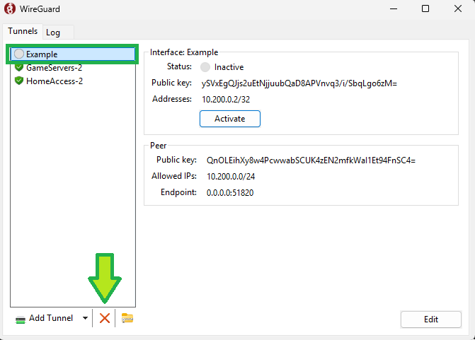
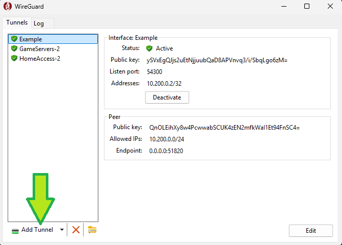
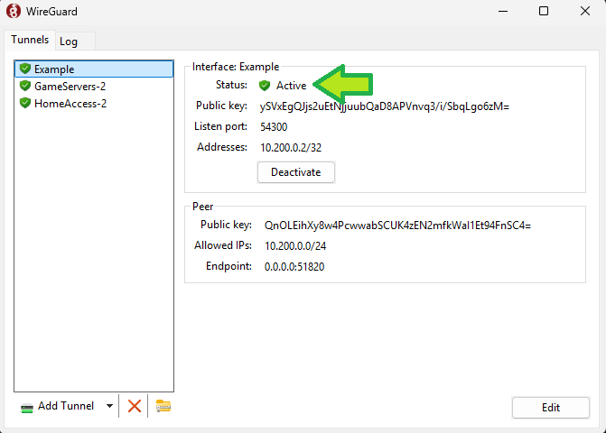
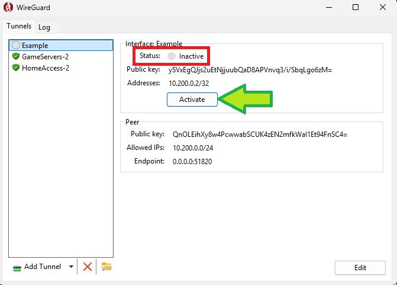

# Table of Contents

* TOC
{:toc}

# Overview
These instructions go over how to install a new WireGuard profile if your previous one stopped working.

# Instructions

## 1. Open WireGuard

In your operating system, open WireGuard (it can be helpful to search for it)

## 2.  Remove the old WireGuard profile

Select the WireGuard profile you wish to remove, and click the red X button near the bottom of the window.

## 3.  Download and install the WireGuard profile

You will receive a WireGuard profile (for example, "YourName.conf").  If you have not received one, email Matt to receive your WireGuard profile.

To install the profile, open WireGuard and click the "Add Tunnel" button.  Find the configuration file (ending in .conf) and open it.

## 4.  Ensure that WireGuard is connected

Make sure you see "Status: Active" near the top of the WireGuard window:

If the status of your WireGuard connection is "Inactive", then press the "Activate" button.

## 5.  Test your Game Server connection

Try your normal connection to either Minecraft or Factorio.  For further troubleshooting help, shoot Matt an email or a DM.